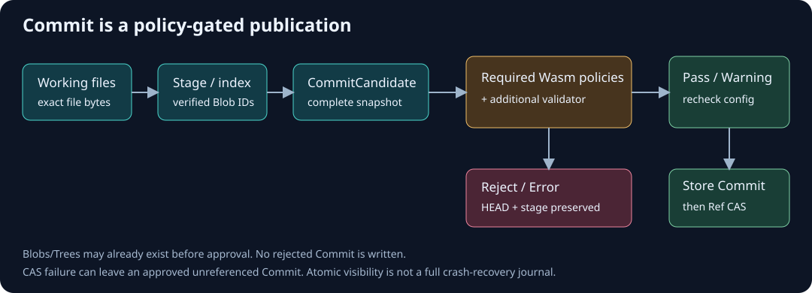
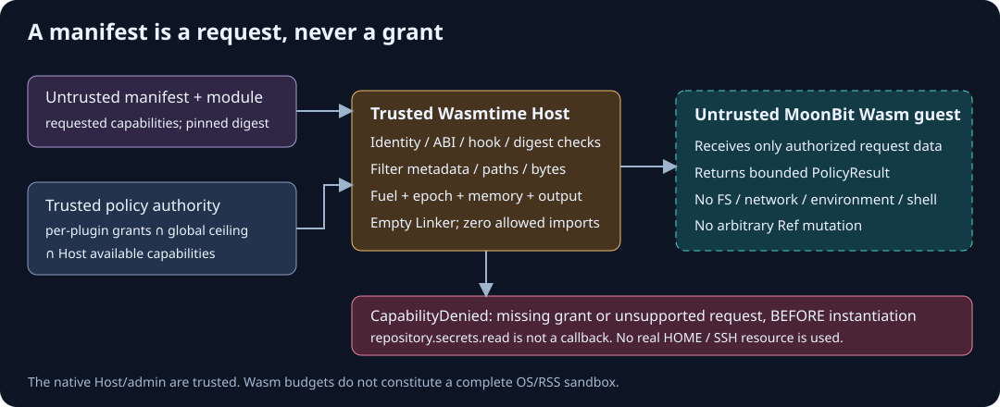
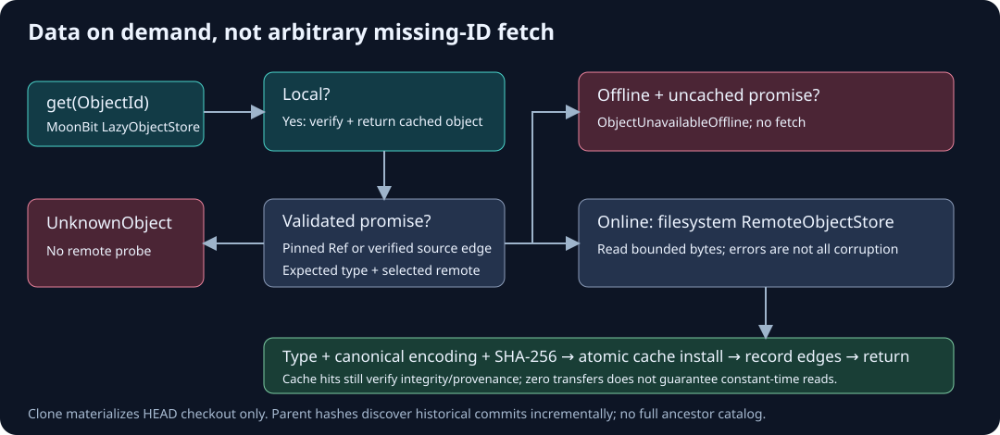

# MoonVCS：当前系统架构

本文描述已实现的路径，不是未来规划。更细的实现演进见 [docs/ARCHITECTURE.md](docs/ARCHITECTURE.md)。

## 1. 系统分层

| 层 | 语言 / 代码 | 职责 |
|---|---|---|
| VCS Core | [MoonBit model](vcs/model.mbt)、[encoding](vcs/encoding.mbt)、[repository](vcs/repository.mbt) | typed Blob/Tree/Commit、Stage、CommitCandidate、SHA-256、Ref CAS |
| Storage | [MoonBit lazy_store](vcs/lazy_store.mbt)、[clone](vcs/clone.mbt) | Local/Remote/Lazy、promise、完整性校验、按需缓存、HEAD checkout |
| Policy Engine | [MoonBit policy_engine](vcs/policy_engine.mbt) | 可信 required policy 配置、确定顺序、候选请求、聚合结果 |
| Plugin Host | [Rust + Wasmtime](host/src/main.rs) | Manifest/pin/ABI/import 审计、授权交集、请求过滤、资源预算 |
| Policies | [MoonBit Scanner](plugins/secret-scanner/gen/interface/moonvcs/policy/evaluator/stub.mbt)、[License](plugins/license-check/gen/interface/moonvcs/policy/evaluator/stub.mbt) | 具体规则与结构化诊断；编译为 Wasm Component |
| Receiver | [MoonBit receive](vcs/receive.mbt)、[protocol](vcs/receive_protocol.mbt) | Quarantine、图验证、服务端策略、最终配置/旧 Ref 复核与发布 |

Python 和 Shell 只负责测试、基准、打包和演示编排，不实现正式 VCS 或策略规则。

## 2. Commit 生命周期

Working Directory → add/Stage → canonical Tree + CommitCandidate →
Required Policy Engine → 实际 Wasmtime/MoonBit Wasm →
额外 validator → 配置复核 → 写入 Commit → 锁定旧值 CAS Ref。

候选内容来自已校验的暂存 Blob，不重新读取工作区。Reject/Error 不写 Commit、不更新 HEAD，
保留工作区和暂存内容。Blob/Tree 可以提前存在；批准后 CAS 失败可留下不可达 Commit。
普通 Mock Pass 是额外验证器，不能替换 required gate。详见 [Policy 边界](docs/POLICY_ENGINE.md)。

暂存并发不依赖 Ref CAS：当前 add 在读取 index 前获取 staging-transaction.lock，
持有到完整读改写与发布结束。旧实现的丢失更新已用两个真实 CLI 的读取屏障复现并修复。
等待最多 30 秒，超时返回 StagingBusy（15）；旧 index.lock 不会被自动删除。

## 3. Wasm 权限与资源边界

有效授权 = Requested ∩ per-plugin Granted ∩ Repository Ceiling ∩ Host Available。
Manifest 是不可信请求，不是授权。当前四种数据能力：

| 能力 | 含义 |
|---|---|
| staged_content.list | 文件名，内容为空 |
| staged_content.read | 候选文件名及字节，不是文件系统路径访问权 |
| commit_metadata.read | 提交消息与可选 parent/tree ID |
| diagnostic.emit | 返回有界诊断，不是通用日志或 Shell 接口 |

第一版没有 Host 回调或 WASI；Host 向 guest 复制授权后的请求数据。
不支持的或未授予的必需请求在实例化前返回 CapabilityDenied。
Restricted Plugin 的读取成功是对实际输入的检验，不是一次虚构的文件 API 调用。

统一 [WIT](wit/policy.wit)：package moonvcs:policy@0.1.0、ABI 1，evaluate 接收请求并返回
Pass/Reject/Error 与诊断；Warning 用 Pass + warning diagnostics 表达。
插件名称/版本/摘要单独绑定。WIT 只带一个可选 Parent；多 Parent 历史在本 MVP 中明确拒绝。
Fuel 不替代 wall-clock：另有 epoch、中断、内存/输入/输出/日志上限及原生 child 超时。
Host、Core、配置管理者仍属可信计算基，不是 OS 多租户隔离。见 [SECURITY.md](SECURITY.md)。

三项安全保证不能混用：guest 线性内存限额不覆盖 Host/JIT 总 RSS；
组件摘要和名称/版本 pin 不是作者身份认证或签名验证；
有界 diagnostic.emit 也不保证内容保密。获准读取候选内容并输出诊断的恶意插件仍可回显这些内容，
Host 没有通用敏感内容脱敏机制；现有 Scanner 的脱敏只是该插件的规则行为与测试结果。

## 4. Lazy Fetch 数据流

ObjectId = SHA256(类型、版本、长度分隔后的规范化对象编码)，本地/远端不另设编码。
ObjectStore 接口保持 put/get/has/verify；磁盘路径和传输属于 adapter。

- Local：读取并验证；完整性策略不会把损坏缓存自动当成 miss。
- PromisedRemote：仅来自操作者选定的 Ref 或已验证来源对象的直接边；允许按需获取。
- Unknown：没有获取关系，不因任意 hash 就探测远端。
- 缓存 miss 且有 promise：受控读取文件系统远端 → 类型/规范化/SHA-256 → 原子安装缓存 →
  登记直接边 → 返回。离线未缓存是 ObjectUnavailableOffline。

Clone 只下载 HEAD 的 Commit/Tree/Blob 与 checkout 所需数据，保留父 hash；
log 逐步发现并拉取旧 Commit，不预先知道全部祖先。缓存可以只增不减；未实现 LRU。
这里的 checkout 指 clone 初始化时物化固定 HEAD；另有下述已有本地分支 switch，不是通用 checkout 命令。
diff 已在 MoonBit 中实现 index→工作区、HEAD→index、HEAD→工作区比较；
使用只读本地对象读取与哈希/类型验证，不调用会 Fetch/修复元数据的 LazyObjectStore.get。
缺失本地对象明确失败，不能从 diff 成功推导 promisor 来源已认证。详见 [DIFF.md](docs/DIFF.md)。
MoonBit [checkout.mbt](vcs/checkout.mbt) 实现分支列出/从 HEAD 创建与已有本地分支 switch。
只读计划完整验证当前/目标快照及碰撞；持共享 staging-transaction advisory lock 再验证，先准备私有事务，
将旧 inode 无覆盖移入 before/、将准备好的目标文件无覆盖安装，最后分步发布 index 和 HEAD。
成功事务保留至 switch-history；未完成事务阻止普通写入，recover 只读报告身份、phase 与 HEAD/index 观察。
add/commit/branch/switch 和 receive 最终发布共用锁域，receive 先取 receive-publish 再取 staging，禁止反向锁序。
这不是 HEAD/index 的单次原子发布或自动恢复；详见先行 [安全契约](BRANCH_SWITCH.md)。
merge、通用 checkout 和 Git 协议仍未实现。
缓存命中仍有校验成本，尤其宽 Tree，不等于常数时间。见 [Lazy Storage](docs/LAZY_STORAGE.md)。
每次 get 在 fetch lock 内建立请求私有的来源类型/边索引；最多 16 来源、16384 边，超限退回原始
hash/解码/线性边检查。promise 身份、anchor、来源记录和类型仍逐条检查；下一次 get 重新验证 hash。
不保存全局“已可信”标志，不承诺抵抗同账户绕过锁修改对象。[实现与配对测量](docs/ROUND2_VALIDATION.md)

## 5. 独立 Remote Receive

不可信 client bundle → Quarantine → hash/type/canonical/完整图检查 →
服务端 receive-policies → 每个可达线性 Commit 的完整快照扫描 →
发布锁 → 配置/旧 Ref/已有正式对象复核 → promote → 原子 Ref CAS。

客户端扫描结果不进入 wire。服务端 required policy 版本与摘要不来自提交内容；
已有历史和新分支复用对象在下一次更新时按当前策略重新检查。
普通失败/取消清理 owned Quarantine；进程死亡和多对象 promote 不构成完整 crash transaction。
当前是文件系统/stdio、完整服务端仓库、单 Ref 和线性 fast-forward/new branch。
每次候选目标的完整可达图至多 4096 个不同对象、128 个 Commit，包括服务器已有祖先，
不是只限制新增上传。全部可达 Commit 的完整快照都按当前 required policies 重新检查，
没有审批结果复用；对象去重不等于免除重复策略扫描。历史增长会增加校验工作，超限即拒绝，
并非保证在上限规模下满足某个时延。本地 10000 对象的存储/clone 基准不是接收端基准。
无认证/TLS/ACL/OS 权限分离；同一账户可直接改文件，不能宣传为生产级安全服务。
这里“独立”仅指接收进程及验证路径不信任客户端扫描结果，不表示不同 OS 身份或文件访问权限。
能直接写服务器对象、Ref、策略或运行文件的同账户进程可以绕过 receive；
清空子进程环境、Quarantine 的 0700 权限和 CAS 均不能解决这个部署缺口。
[完整协议、预算和重试语义](docs/REMOTE_RECEIVE.md)

## 6. 兼容性与证据

WIT v1、对象编码 v1 和现有组件 pin 在最终交付阶段保持不变。
CLI 显示转义不改变存储字节。关键对象/元数据/Ref 发布采用文件 sync、rename、父目录 sync；
目录同步失败且 rename 已成功时返回 PublicationUncertain（16），不能假定回滚。
这些步骤不等于完整掉电恢复；没有恢复日志或 GC，进程死亡仍可能残留
index/Ref 排他锁文件、临时对象或 Quarantine。普通异常/取消的 defer 清理不是异常退出恢复协议。
fetch/receive 的 advisory lock 文件可以持续存在，不能仅凭文件存在就判断锁仍被持有或应被删除。
Quarantine 有 active.lock lease；[recover --check](docs/RECOVERY.md) 只读检查，不清理或重放。
[序列化规格](docs/OBJECT_FORMAT.md) · [接口](docs/INTERFACES.md) ·
[设计决策](docs/DECISIONS.md) · [测试与证据](TESTING.md) · [已知问题](docs/KNOWN_LIMITATIONS.md)
