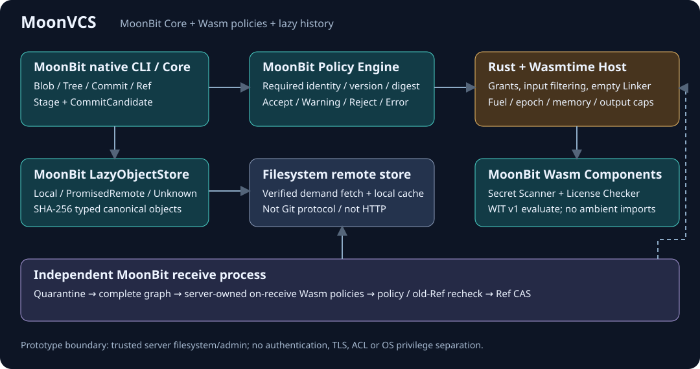

# MoonVCS

A capability-secure, programmable version control system with lazy history.

用 MoonBit 实现版本控制核心和 Wasm 策略插件，在本地 Commit 与远端 Ref 发布前执行受控策略，
并只在需要时获取历史对象。一个可运行、可测试的系统软件黑客松原型，不是生产级 Git 替代品。

完成口径：“八阶段完成”仅指当前收敛后的原型范围已完成阶段性验证与交付，
不代表最初功能愿景全部实现。diff、最小 branch 与已有本地分支的保守 switch 已实现；
merge、任意版本恢复、通用 checkout 和 Git 协议仍未实现。
switch 要求 index/跟踪文件干净，无未跟踪碰撞，且目标对象已在本地；[安全契约](BRANCH_SWITCH.md)先于实现制定。

远端边界：当前仅有本地文件系统/标准输入输出（stdio）原型，没有认证、ACL、TLS 或服务端 OS 权限分离。
独立 receive 进程只独立执行接收验证，不建立权限隔离；同一 OS 账户仍能直接修改服务器对象、Ref 和策略。

[三分钟演示](DEMO.md) · [系统架构](ARCHITECTURE.md) · [测试与证据](TESTING.md) ·
[竞品差异](docs/COMPARISON.md) · [安全边界](SECURITY.md) · [路线图](ROADMAP.md)

[GitHub Actions 配置](.github/workflows/ci.yml)已接入固定工具、构建和完整验证，说明见 [CI.md](docs/CI.md)。
GitHub [运行 #2](https://github.com/any07557-wq/MoonBitCVS/actions/runs/39373597127) 对提交 `58bade3` 实际成功，
237 项及重复演示通过；新旧附件分别校验归档，见 [CI 验证记录](docs/CI_VALIDATION.md)。
成功只绑定各自被测提交，不替代后续修改或新 rootfs 冷安装验收。

本地交付包与验包方式见 [SUBMISSION.md](docs/SUBMISSION.md)。源码包与实测证据分开保存，不含工具链或预编译发行版。
Mooncakes 已发布 [any07557-wq/moonvcs@0.1.0](https://mooncakes.io/docs/any07557-wq/moonvcs)：
**仅原生核心库源码**，不含完整 Rust Host、Wasm 插件或预编译 CLI。
冻结源码 `d5d8242` 完整验证 237 项通过；新 registry consumer 的 2 项测试和示例运行另列，
下载 ZIP 与冻结包逐字节一致。见 [发布记录与证据](docs/MOONCAKES_RELEASE.md)；本次没有推送 GitHub 或新 CI 运行。

后续工程的实际结果见 [路线图执行记录](docs/ROADMAP_PROGRESS.md)：并发暂存已修复，
宽 Tree 已取得指令/IO 证据，并新增只读恢复检查；完整掉电恢复和 GC 仍未实现。

## 要解决什么问题

版本控制扩展同时面对三个问题：策略代码能接触哪些数据、失败能否真正阻止发布，以及使用者是否需要预先下载全部历史。
MoonVCS 把它们放在同一条可检查的路径里：

    MoonBit VCS → 候选提交 → Wasm 策略 → 权限/资源边界 → 提交与 Ref CAS
           └→ Local / PromisedRemote / Unknown → 按需校验、获取和缓存历史

Lazy Fetch、内容寻址、Secret Scanning 和策略 Hook 都已有成熟先例。我们的探索是它们与
MoonBit 插件开发、显式 Capability 和 VCS 生命周期的组合，而不是声称发明上述单项技术。

## 为什么不是简单重写 Git

最小 Blob/Tree/Commit/Ref 模型是验证策略边界和 Lazy Storage 的载体。项目不实现 Git 对象格式、
Git 网络协议或完整 Merge/Rebase；重点是“真正参与发布决策的受控 Wasm 策略”，不是命令数量。

Git 本来就有 Partial Clone，也有能拒绝推送的服务端 Hook，不能把它描述为没有这些能力。
参见 [Git Partial Clone](https://git-scm.com/docs/partial-clone)、
[Git hooks](https://git-scm.com/docs/githooks) 和[完整比较](docs/COMPARISON.md)。

## 为什么使用 MoonBit 与 Wasm

- MoonBit 不只是两个演示插件：它实现[对象/类型模型](vcs/model.mbt)、[规范化编码](vcs/encoding.mbt)、
  [本地仓库与提交](vcs/repository.mbt)、[Policy Engine](vcs/policy_engine.mbt)、
  [Lazy Store](vcs/lazy_store.mbt) 和[远端接收事务](vcs/receive.mbt)。
- [Secret Scanner](plugins/secret-scanner/gen/interface/moonvcs/policy/evaluator/stub.mbt) 和
  [License Checker](plugins/license-check/gen/interface/moonvcs/policy/evaluator/stub.mbt)
  也由 MoonBit 编写，实际编译为 Wasm Component。
- 强类型 ObjectId、VcsObject、CommitCandidate 和策略结果明确表达验证边界；Rust 只承担必要的
  [Wasmtime 宿主](host/src/main.rs)、绑定、能力过滤和运行预算。
- 同一个 [WIT v1](wit/policy.wit) 支持多个真实策略。跨宿主复用是接口潜力：
  当前只验证 Wasmtime，没有声称验证浏览器或其他运行时。

没有测量或宣称 MoonBit 相比其他语言具有速度、RSS 或 Wasm 体积优势。

## Wasm Policy 与 Git Hook 有什么不同

Hook 是生命周期入口；沙箱是执行与数据权限模型。Git 的客户端 pre-commit 可以跳过，
服务端 pre-receive 则能独立拒绝 Ref 更新。MoonVCS 同样不信任客户端的检查结果。
[官方 Hook 语义](https://git-scm.com/docs/githooks)

本原型额外固定策略 ABI、版本/摘要、显式授权、过滤后的输入以及 fuel/epoch/内存/输出预算。
插件不能因为在 Manifest 中请求能力就获得授权，也没有任意文件系统、网络、环境变量或 Shell imports。
Git Hook 也可以调用沙箱程序；我们没有证明这种组合只能在 MoonVCS 中实现。

## 已实现的架构

本地提交先运行 required Wasm policies；远端 receive 则使用独立服务端配置，
从 Quarantine 中验证实际对象图，并扫描目标可达的全部线性历史快照，最终复核配置和旧 Ref 后 CAS 发布。
详见 [ARCHITECTURE.md](ARCHITECTURE.md) 与 [Remote Receive](docs/REMOTE_RECEIVE.md)。

## 现在真的可以运行什么

| 能力 | 实际范围与证据 |
|---|---|
| 本地 VCS | init / add / status / diff / branch / switch / commit / log / show；Blob、Tree、Commit、Ref、SHA-256 对象库 |
| 提交前 diff | 工作区/暂存区/HEAD 三组比较，新增/修改/删除、空文件/二进制、路径筛选；只读且不隐式 Fetch，见 [使用边界](docs/DIFF.md) |
| 分支与安全切换 | 列出/从 HEAD 创建、不覆盖 Ref；switch --dry-run 完整预检；共享写锁、无覆盖安装、旧文件保留、pending 门禁与只读恢复身份/阶段检查；无 force/自动回滚 |
| 策略参与提交 | 真实 Wasm Scanner Reject 阻止 Commit；修复并重新暂存后 Pass |
| 多插件 | Scanner + License Checker，统一 ABI、确定顺序、Warning/Reject/Error 聚合 |
| 权限与资源限制 | 过滤请求、未授权请求拒绝、无 imports、fuel/epoch/线性内存/输入输出日志上限 |
| Lazy History | 文件系统 partial clone，只取 HEAD checkout；旧 Commit 按需获取、校验、缓存、离线错误分类 |
| Remote Policy | 本地文件系统/stdio receive、required policies、Quarantine、图校验和 Ref CAS；经 receive 入口的未扫描候选仍被拒绝，不防同账户直接改服务器文件 |
| 暂存与恢复检查 | 跨进程 add 事务锁、关键目录同步；recover --check 只读检查锁/临时对象/Quarantine，不自动清理或重放 |
| 测试 | branch/switch 的 225 项验收与交付轮 231 项记录分别保留；提交 6d96157 的 GitHub CI 237 项通过，报告已核验归档；149 项冷安装仍是历史版本 |

安全模型和规模上限不是无限的，见下方限制及 [SECURITY.md](SECURITY.md)。

## 快速安装：源码构建

公开源码仓库为 [any07557-wq/MoonBit_Program](https://github.com/any07557-wq/MoonBit_Program)，
尚未发布预编译安装包或容器镜像。取得本项目源码后，
先按 [INSTALL.md](INSTALL.md) 准备锁定工具链。已验证 Linux x86_64/WSL2：

| 工具 | 已验证版本 |
|---|---|
| MoonBit | moon 0.1.20261012 / moonc 0.10.15 |
| Rust / Cargo | 1.99.1 |
| wit-bindgen-cli / wasm-tools | 0.63.0 / 1.262.0 |
| Wasmtime crate | 49.0.3，Cargo.lock 锁定 |
| Native C / Python | GCC 15.2.0 / Python 3.14.4（测试编排只用标准库） |
| Mooncakes | gmlewis/sha256 0.18.0、moonbitlang/async 0.20.2 |

已有这些工具时，在项目根目录执行：

~~~bash
export MOONVCS_MOON="$HOME/.moon/bin/moon"   # 或你的实际 moon 路径
"$MOONVCS_MOON" -C vcs update               # 首次安装需初始化 Mooncakes registry；离线缓存已准备时可跳过
./scripts/build-vcs.sh
export PATH="$PWD/target/bin:$PATH"
~~~

该命令实际构建组件、Host 与原生 CLI，并运行构建所需测试；输出位于 target/bin 和 target/components。
生成的 MoonBit WIT 绑定已随源码提供。项目本地 .toolchains 不随源码交付，
移动运行目录后需要重建配置中的绝对路径与 pin，不要静默修改摘要。

最终安装脚本和本地 MoonBit 归档已在独立 Linux/amd64 OCI rootfs 完成端到端验收：
149 项完整回归及四个真实演示通过，没有挂载宿主工具链或 registry 缓存。
本轮镜像下载 401 的失败、续期修复与全新目录重跑均保留；第一轮 134 项报告没有被改写。
这共享宿主内核和网络，不是物理空白 OS、其他平台或完整离线安装证明。
[本轮安装记录](docs/FRESH_INSTALL_VALIDATION.md) · [第二轮验证](docs/ROUND2_VALIDATION.md)

该 149 项隔离安装对应增加 diff 之前的源码，不自动证明本轮 diff 已在空环境安装验证。

## Quick Start

构建并加入 PATH 后：

~~~bash
MOONVCS_EXAMPLE="$(mktemp -d /tmp/moonvcs-quickstart.XXXXXX)"
cd "$MOONVCS_EXAMPLE"
moonvcs init
printf 'APP_MODE=demo\n' >config.env
moonvcs add config.env
moonvcs status
moonvcs diff --staged             # 确认本次实际暂存内容
moonvcs commit -m "initial safe config"
printf 'APP_MODE=updated\n' >config.env
moonvcs diff                      # 暂存区 → 工作区；不自动 add
moonvcs log
moonvcs show HEAD
~~~

新仓库默认绑定 Secret Scanner 的名称、版本和 SHA-256。提交中的实际暂存字节被扫描，
不是工作区文件的后来修改。对象位于 .moonvcs/objects/；CLI 控制字符显示经过转义，
show 是检查视图，不是原始字节导出。
`diff --staged` 是 HEAD → 暂存区，`diff HEAD` 是 HEAD → 工作区；纯未跟踪文件先 add 才会展示。
diff 是经过显示转义的检查视图，不是可直接 apply 的补丁；文本差异不作 Secret 脱敏。

接着试分支切换（接续上面的、已有未暂存修改的示例）：

~~~bash
moonvcs branch demo               # 从当前已提交的 HEAD 创建，不包含工作区新修改
moonvcs branch
moonvcs add config.env
moonvcs commit -m "updated config"
moonvcs switch --dry-run demo     # 只读，列出目标和新增/替换/删除路径
moonvcs switch demo               # 恢复该分支快照；不改任一分支的 Ref
~~~

切换中断或报 16/18 时停止写入，执行 `moonvcs recover --check` 并按 [BRANCH_SWITCH.md](BRANCH_SWITCH.md)
保留整个工作区、事务和备份；不要盲重试或删除锁。成功切换也保留私有旧文件备份，
位于 `.moonvcs/switch-history/<transaction-id>/before/`，磁盘占用会增长，没有自动 GC/清理。
拥有者的证据保留与新目录重建流程见 [人工恢复演练](docs/SWITCH_MANUAL_RECOVERY.md)。

## 四个真实演示

在项目根目录提前构建；准备历史不计入台上三分钟：

~~~bash
python3 scripts/hackathon-demo.py prepare --workdir target/hackathon-demo --commits 40
python3 scripts/hackathon-demo.py run --workdir target/hackathon-demo --only all
~~~

prepare 要求目录不存在，不会覆盖已有仓库。run 每次创建全新演示仓库，可重复执行。
可以用 --only secret / capability / lazy / remote 分段；每次生成实际 terminal.txt 和 result.json。

1. 无害模拟密钥：add → 真实 Scanner → Reject → 修复、重新 add → Commit。
2. Restricted Plugin：授权读取成功；缺少授权/请求不支持能力，真实返回 CapabilityDenied。
3. Lazy History：实时统计远端 N、初始缓存 M 与字节数，访问旧 Commit 后出现 Fetch/Hash Verified/Cached。
4. Remote Policy：独立测试客户端直接构造未扫描对象，服务端再次执行 Wasm 并拒绝；HEAD 不变，Quarantine 清空。

三分钟讲稿、手工步骤、失败预案和终端录制见 [DEMO.md](DEMO.md)。
另有 [可运行示例文件](examples/vcs-demo/) 与[技术亮点摘要](docs/HACKATHON.md)。

## 测试与实测数据

~~~bash
MOONVCS_MOON="$HOME/.moon/bin/moon" ./scripts/test.sh
MOONVCS_MOON="$HOME/.moon/bin/moon" ./scripts/verify.sh --clean-build --benchmark
~~~

225 = 86 原生 + 26 Rust + 19 Wasm 插件 + 9 独立系统审计 + 6 验证脚本 + 4 跨进程暂存 +
7 恢复检查 + 1 读取计数 + 7 工具归档/Registry 续期 + 20 diff CLI + 40 branch/switch CLI，
不把重复构建重复计数；阶段 8 的双轮四场景 smoke 另列。所有演示使用真实插件和无害数据。
此前 diff 轮新增 8 项 native + 20 项 CLI；本轮 branch/switch 新增 8 项 native + 38 项 CLI。
后续收尾新增帮助提示与人工恢复演练 2 项，已重新运行完整入口；
见 [最终独立验收](docs/BRANCH_SWITCH_ACCEPTANCE.md)、[diff 历史验证](docs/DIFF_VALIDATION.md)与[实现验证（保留失败记录）](docs/BRANCH_SWITCH_VALIDATION.md)。
该 225 项属于 2026-10-18 收尾源码快照。交付复现另加 6 项归档/摘要/失败保留防护，接入统一入口后共 231 项；
打包不等于验证，具体源码包的清洁解包重建结果见包旁 `REPRODUCTION.json` 与 `REPRODUCTION.md`。
复现方式与已安装工具/缓存复用边界见 [交付说明](docs/SUBMISSION.md)。
随后 CI 轮新增 6 项工作流/安装防护，当前入口为 237 项；提交 `6d96157` 的 GitHub 运行与原始附件已独立核对，
见 [CI 验证记录](docs/CI_VALIDATION.md)，与此前本地结果分开记录。

阶段 7 正式基准：每档 20 个真实策略提交、3 轮；这里仅报告本地部分克隆和 Commit，
不是 Git 对比：

| 对象总数 | Commit 中位 ms | Clone 中位 ms | 初始下载对象 / 编码字节 |
|---:|---:|---:|---:|
| 100 | 350.76 | 204.86 | 5 / 540 |
| 1000 | 396.61 | 1511.93 | 50 / 5445 |
| 10000 | 1041.37 | 15059.03 | 500 / 54495 |

对象数不是单个快照的文件数。历史基准中，10000 对象、498 文件/快照的同一 Tree，
缓存读取中位 2165.92 ms（约 2.17 秒），首次读取 1856.86 ms（约 1.86 秒）。
以上是历史结果，不覆盖本轮改进。单次 get 内的有界来源/边索引复用已实现；同机配对的宽 Tree
缓存读取中位从 2093.86 ms 降为 961.39 ms，逻辑 Tree 读取 499 → 1 次，promise 读取仍为 998 次。
计时包括独立 CLI 全流程；这不是三档基准重跑、CPU 时间占比或通用缓存速度保证。
P7-001 已针对性缓解但仍接近 1 秒；剩余性能风险没有整体关闭。[配对方法与原始结果](docs/ROUND2_VALIDATION.md)
[完整方法与原始数据说明](docs/BENCHMARKS.md) · [测试入口](TESTING.md) · [阶段 7 审计](docs/PHASE7_SECURITY_AUDIT.md)

## Known Limitations

- 研究原型，尚无认证、ACL、TLS 或服务端 OS 权限分离。同一 OS 账户可以直接修改服务器文件。
- Wasm guest 线性内存预算不覆盖 Host/JIT 总内存或总 RSS；没有 OS 级总进程内存限额。
- 插件摘要与名称/版本 pin 只绑定所批准的组件字节，不证明作者身份、发布来源或代码无恶意；没有签名验证。
- 同时获准 staged_content.read 和 diagnostic.emit 的恶意插件仍可在有界诊断中回显获准内容；
  输出大小限制不等于保密，Scanner 的脱敏规则不构成 Host 对任意插件的通用脱敏保证。
- Remote Receive 仅完整服务端仓库、单 Ref、新分支或线性 fast-forward；上限 4096 图对象、128 Commit。
  上限计入候选目标的完整可达历史，包括服务器已有祖先，不只计算新增上传，也不是仓库全局对象总数上限。
  每次仍扫描全部可达 Commit 的完整快照，没有审批结果复用；历史、快照和策略数量增长会增加成本。
  这些是拒绝阈值，不是吞吐量或时延保证；10000 对象本地基准不代表能推送同规模对象图。
- 未实现分支删除/重命名、force/自动恢复、merge、通用 checkout、Git 协议、Rebase、HTTP Remote 或浏览器 UI；
  clone 的 HEAD 物化不是通用 checkout。Scanner/License 规则是演示级规则。
- 当前版本已用跨进程事务锁保护 add 的完整读改写；不保证旧版本或不协作写入者遵守该锁。
- 对象/元数据/Ref 关键路径已增加父目录同步，但没有完整掉电恢复、恢复日志或 GC。
  异常退出可能残留排他锁文件、临时对象或私有 Quarantine；批准后 CAS/IO 失败可能留下不可达对象。
- moonvcs recover --check 只读报告残留和 lease 状态，不自动清理、回滚或发布；参见 [恢复边界](docs/RECOVERY.md)。
- 宽 Tree 的单次 get 重复来源验证已缓解，provenance 元数据检查仍有成本；没有 LRU 或自动回收/恢复工具。
- 独立 rootfs 安装已验证；物理空白 OS、其他平台、CVE 数据库扫描、长期 fuzz、形式化沙箱证明均未验证。

[完整已知问题](docs/KNOWN_LIMITATIONS.md) · [安全假设](SECURITY.md) · [按优先级路线图](ROADMAP.md)

## 代码与交付导航

| 路径 | 内容 |
|---|---|
| vcs/ | MoonBit Core、存储、CLI、Policy Engine、Receive 和测试 |
| plugins/ | MoonBit Wasm 插件、Manifest、已生成绑定 |
| host/ | Rust + Wasmtime Host、Cargo.lock 与安全测试 |
| wit/policy.wit | 已验证且未改动的 WIT v1 |
| scripts/、tests/、examples/ | 构建/测试/演示脚本、恶意 fixture、可运行示例 |
| ARCHITECTURE.md、SECURITY.md、ROADMAP.md | 当前设计、安全边界、未来工作 |
| DEMO.md、TESTING.md、docs/CLAIMS.md | 演示、复现、逐项证据索引 |

源码采用现有 [Apache-2.0 授权声明](LICENSE)。依赖遵循各自许可证；
本项目没有完成第三方发行合规或生产安全认证。
